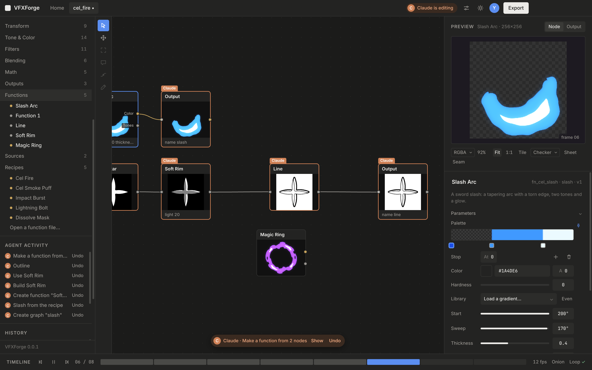
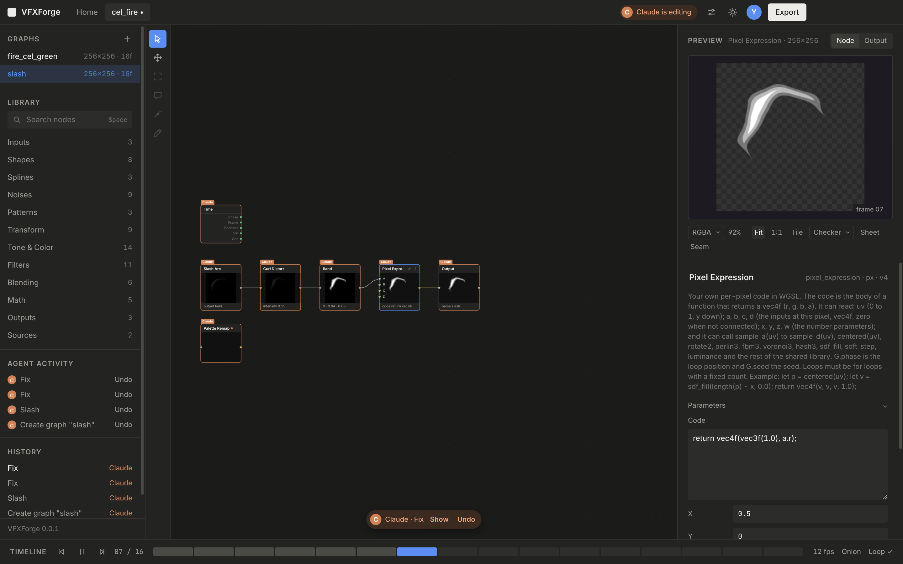
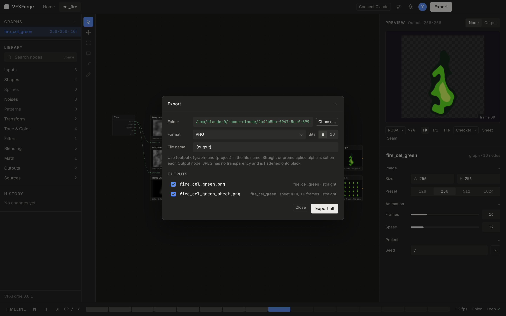
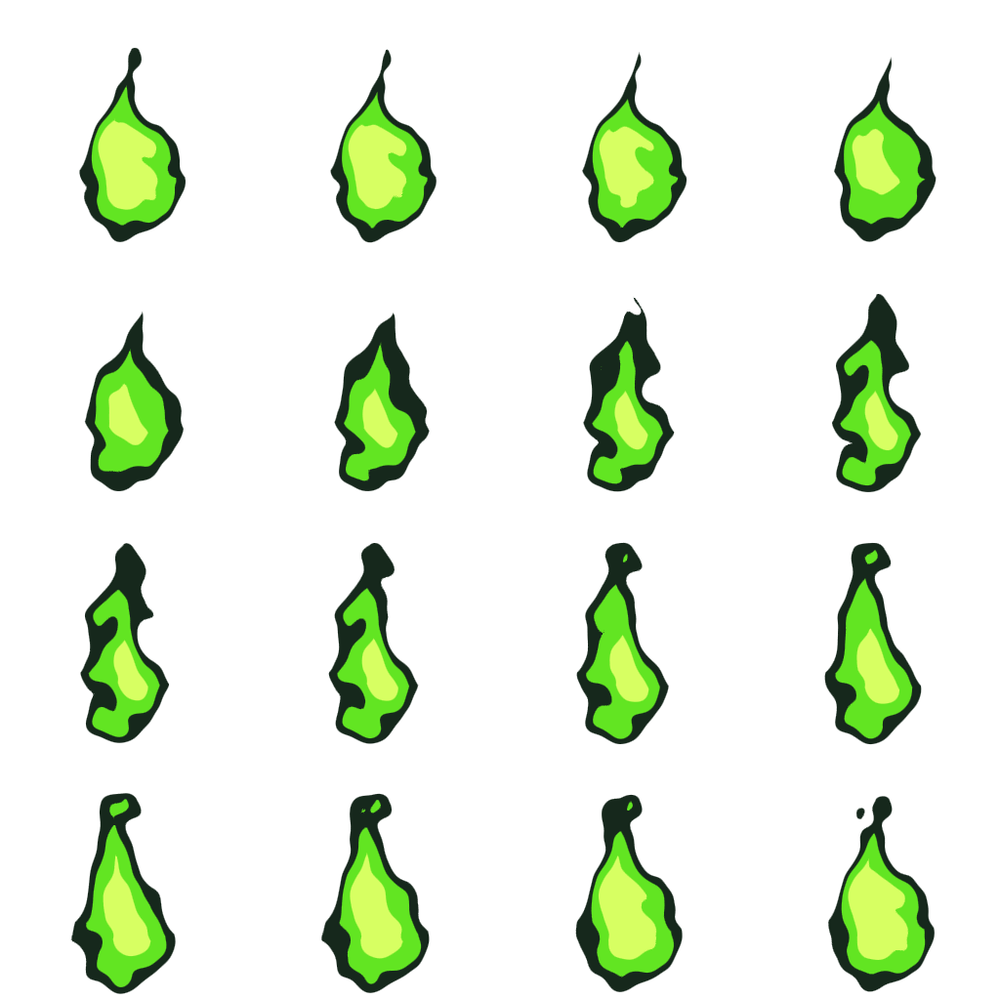
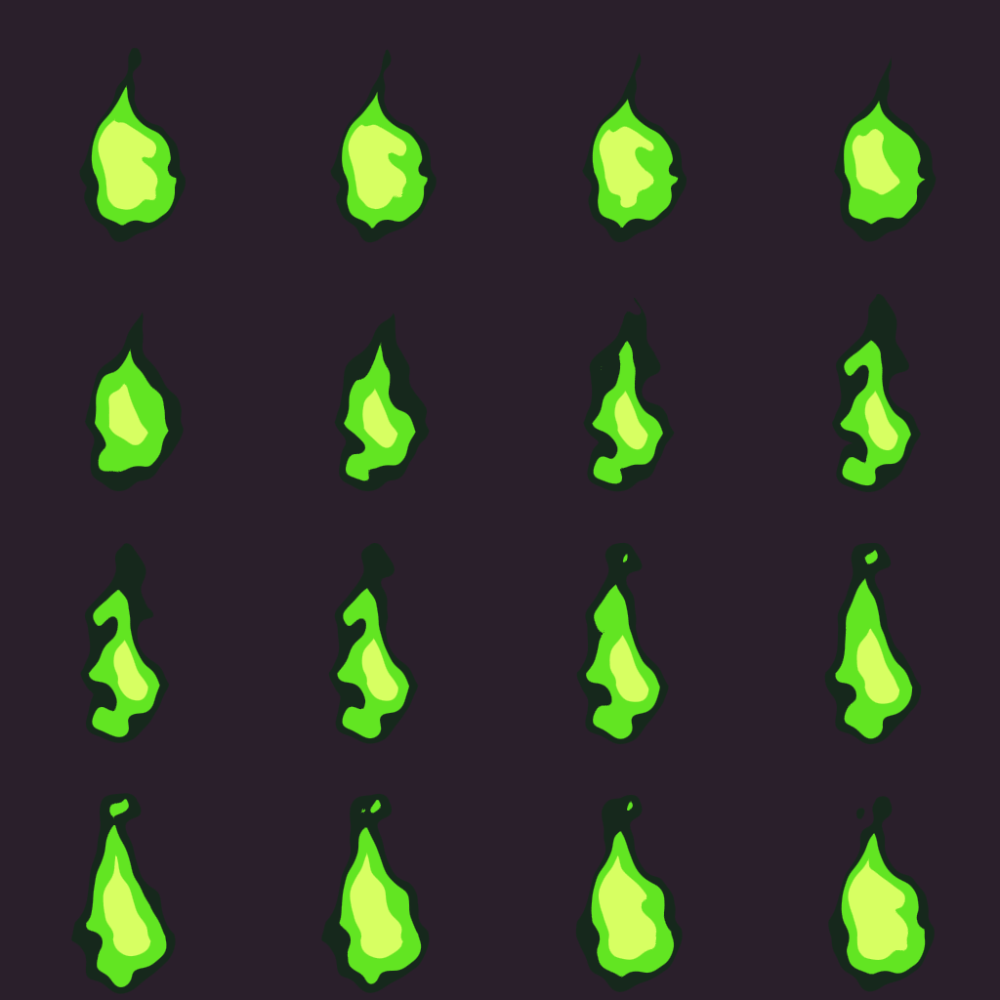

# VFXForge

A node-based VFX texture and sprite-sheet tool, built so a human and an AI agent work on the same graph at the same time.

The full spec lives in [`docs/`](docs/README.md). Build order and acceptance checks are in [`docs/07-roadmap.md`](docs/07-roadmap.md).

## Status

**Phase 7 — Functions, presets and recipes.** A graph can be used as one node in other graphs: select some nodes and press **Make a function**, or turn on "Use as a node" for a whole graph. Pin a parameter to show it on the graph (and on the function's node), and save named **presets** of those values. Seven **recipes** ship in the Library: Cel Fire, Cel Smoke Puff, Slash Arc, Impact Burst, Magic Ring, Lightning Bolt and Dissolve Mask. Functions can be saved as `.vfxfn` files and opened in other projects. Before it: 77 node types including Pixel Expression and Packed Output (Phase 6), export and the Unity link (Phase 5), sprite sheets (Phase 4), the AI Image node (Phase 3b), Claude editing the live graph through MCP (Phase 3) and the dark "Bench" editor (Phase 2). Next: references, comments and snapshots for working with Claude.









## AI images

Add an **AI Image** node (Library › Sources), write a prompt and press **Generate**. Mode *transparent* asks the model for a transparent background; mode *mask* asks for a bright subject on black and turns brightness into alpha. The node outputs the picture and a grayscale mask, so Band and Palette Remap can turn it into flat cel tones.

- **Your key.** Enter your OpenAI API key once in Settings (the sliders button in the title bar). It is encrypted with the operating system's keychain in the app's settings folder. It is sent only to `api.openai.com`; it is never written into a project, never given to the editor window, and agents cannot read it.
- **Your pictures.** Each result is saved as a PNG in `<project>.assets/ai/` next to the `.vfxf`. Opening, rendering and exporting a project never needs the network or the key. Keep that folder with the project when you move it.
- **Cost.** Nothing is generated until you press Generate. Agents can write the prompt, but can only generate if you turn on "Let agents generate images" in Settings, and then only a few times per session.
- **Model.** The default is `gpt-image-2`; change it in Settings when OpenAI releases a newer one. If a model refuses transparent backgrounds, use mask mode.

The **Image Sample** node does the same for a PNG, JPEG or WebP of your own.

## Export and Unity

Press **Export**, choose a folder (for example one inside your Unity project's `Assets/`) and a format. Each texture gets a `<file>.vfxforge.json` next to it with the sheet's columns, rows, frames and speed, the alpha kind and the usage.

In Unity, add the package from git URL `https://github.com/DuzeraFer/VFXForge.git?path=/unity/com.vfxforge.link`. Textures exported into the project then import with the right settings, and **Assets › VFXForge › Create Particle System** makes a Particle System that plays the selected sheet. See [`unity/com.vfxforge.link/README.md`](unity/com.vfxforge.link/README.md). The package has not been run in Unity yet.

Claude can export with the `export` tool, but only into the folder you last exported to or the project's own folder.

## Connect Claude

With VFXForge open, click **Connect Claude** in the title bar. It copies one command; run it once in a terminal:

```
claude mcp add vfxforge -- "C:\path\to\VFXForge.exe" mcp
```

Then ask Claude Code something like "build a cel-shaded fire in VFXForge". The app listens only on this computer, and only for clients that hold the token in its settings folder (`mcp.json`).

- If the app is open, Claude edits the graph you are looking at.
- If it is not, the same command works without a window: `VFXForge.exe mcp project.vfxf` opens that project, and `save_project` writes it back.
- Clients that speak HTTP can connect to the `url` in `mcp.json` with the header `Authorization: Bearer <token>`.

Tools: `get_guide`, `get_basic_info`, `get_selection`, `get_graph`, `get_node`, `list_node_types`, `get_history`, `render`, `render_frames`, `measure`, `apply`, `create_graph`, `list_functions`, `add_function`, `create_function`, `generate_image`, `export`, `set_selection`, `save_project`, `finish_working`. See `docs/05-ai-integration.md`.



## Develop

Requires Node 22+.

```
npm install
npm run dev        # run the app with hot reload
npm run typecheck
npm test                 # unit tests
npm run test:golden      # renders every golden case headless and compares with tests/golden/expected
npm run build            # bundle main, preload and renderer into out/
npm run dist             # Windows portable .exe into release/ (run on Windows)
```

Open a project at startup by passing its path, for example `npm run preview -- src/library/examples/cel_fire.vfxf`.

### Headless rendering

The same engine runs without a window:

```
npx electron . render src/library/examples/cel_fire.vfxf --frame sheet --bg 2a1f2b --out renders
npx electron . export src/library/examples/cel_fire.vfxf --format tga --out exported
npx electron . golden tests/golden [--update]
```

On a machine without a GPU, set `VFXFORGE_SOFTWARE_GPU=1` (and on Linux run under `xvfb-run`).

### Adding a recipe

A recipe is a function file in `src/library/functions/`. Build the function in the app, use "Save as a file…" and put the `.vfxfn` there. Add it to `tests/golden/cases/recipes.vfxf` as well; a unit test checks the two stay the same.

### Adding a node

Add one file in `src/nodes/` that default-exports `defineNode({...})`: sockets, parameter schema, doc string and a WGSL `fn node(uv: vec2f) -> vec4f`. Then add a graph that uses it to `tests/golden/cases/nodes.vfxf` and run `npm run test:golden:update`.

Every push also builds the portable Windows `.exe` in GitHub Actions (artifact `VFXForge-portable`).

## Layout

```
docs/        the spec, plus progress screenshots
unity/       the Unity editor package (VFXForge Link)
electron/    main process, preload, file I/O, headless commands
src/
  app/       React shell, panels, theme tokens, document session
  doc/       document model, ops, history, .vfxf format
  engine/    node API, validation, shader generation, evaluator, shared WGSL
  nodes/     one file per node type
  preview/   preview pane
  headless/  engine entry without UI
  export/    export settings, file names, rendering for export
  library/   example projects and the shipped recipe functions
tests/
  golden/    cases (.vfxf) and expected renders
```
