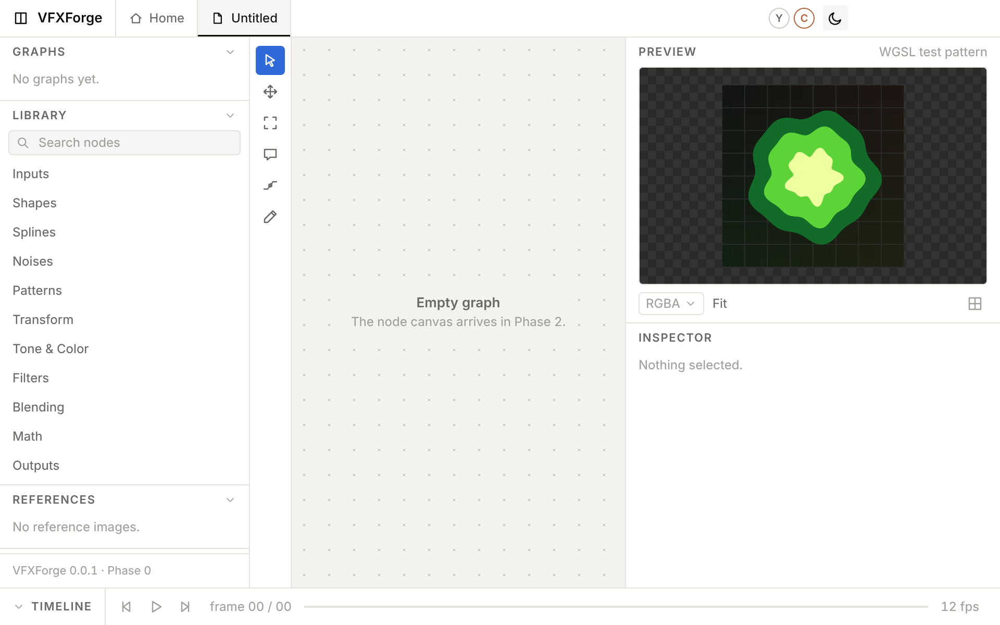

# VFXForge

A node-based VFX texture and sprite-sheet tool, built so a human and an AI agent work on the same graph at the same time.

The full spec lives in [`docs/`](docs/README.md). Build order and acceptance checks are in [`docs/07-roadmap.md`](docs/07-roadmap.md).

## Status

**Phase 0 — Skeleton.** The app opens, shows the empty shell layout in light and dark themes, and draws a WGSL test pattern in Preview through WebGPU.



## Develop

Requires Node 22+.

```
npm install
npm run dev        # run the app with hot reload
npm run typecheck
npm test
npm run build      # bundle main, preload and renderer into out/
npm run dist       # Windows portable .exe into release/ (run on Windows)
```

Every push also builds the portable Windows `.exe` in GitHub Actions (artifact `VFXForge-portable`).

## Layout

```
docs/        the spec, plus progress screenshots
electron/    main process and preload
src/
  app/       React shell, panels, theme tokens
  engine/    WebGPU device and shared WGSL
  preview/   preview pane
tests/
```
